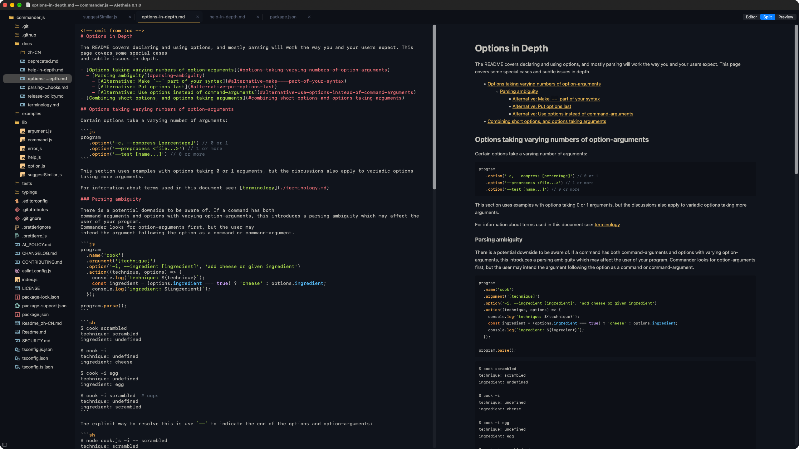
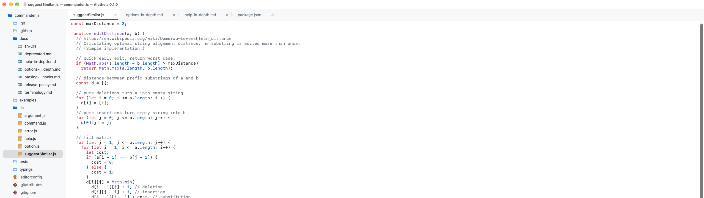
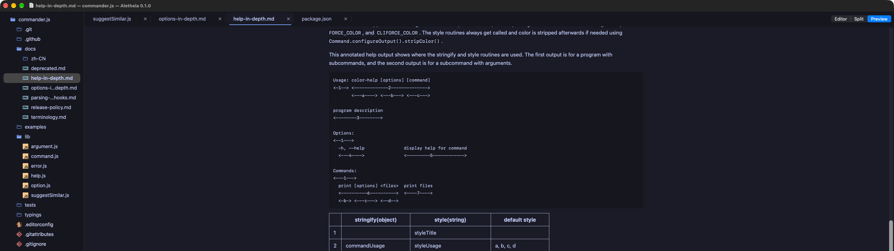

# Aletheia

A small native macOS editor for code and Markdown. File tree on the left, tabs on
the right, and a live Markdown preview next to the source.



## Why

I work on a lot of projects at once and most of them are full of Markdown these
days: plans, notes, specs, instructions for AI agents. I wanted an editor that
shows the rendered file next to the source and gets out of the way. Build for 
project browsing with the occasional edit. 

I couldn't find one I liked. WebStorm and IntelliJ are too heavy to keep open for
ten projects. Zed is fast, but it keeps pushing AI features at me and has no split
Markdown view. So I wrote this.

## What it does

- Opens instantly and stays light. Memory and CPU use are low, and nothing polls
  in the background.
- Markdown opens as a split: source on the left, preview on the right. You can
  switch a file to editor only or preview only.
- The preview is drawn by a custom Core Text renderer (parsing is done by
  swift-cmark). It is fast and it handles GFM tables, task lists and highlighted
  code blocks.
- One window per project. Ctrl+S, then S opens the project switcher, and you can
  bind projects to number keys.
- Every project remembers its full view state: open tabs, scroll positions, tree
  expansion, pane sizes, Markdown modes, window frame. Closing a window loses
  nothing, so I close them all the time.
- Syntax highlighting for TypeScript, JavaScript, JSON, Markdown and the other
  common formats.
- PDFs and images open read-only in tabs.
- The file tree shows Git status colors.
- 74 color schemes applied to the UI, syntax highlighter and even Markdown code 
  blocks.
- Saving checks whether the file changed on disk first, so it never silently
  overwrites someone else's edit.

It has no AI, LSP, completion, terminal, debugger or plugins, and none are planned.





## Build

Requires an Apple Silicon Mac on macOS 26 or newer, and Xcode 26 or newer.

```sh
scripts/bundle-app.sh
open build/Aletheia.app
```

`scripts/install-app.sh` builds and installs into `~/Applications`. `swift test`
runs the tests.

The app is signed ad hoc for local use and is not notarized.

## Credits

Syntax highlighting uses [SwiftHighlight](https://github.com/CreatureSurvive/SwiftHighlight).
Markdown parsing uses [swift-cmark](https://github.com/swiftlang/swift-cmark).
Sources and licenses for the color schemes are in
[theme-authors.md](theme-authors.md).

The files shown in the screenshots are from
[commander.js](https://github.com/tj/commander.js).
